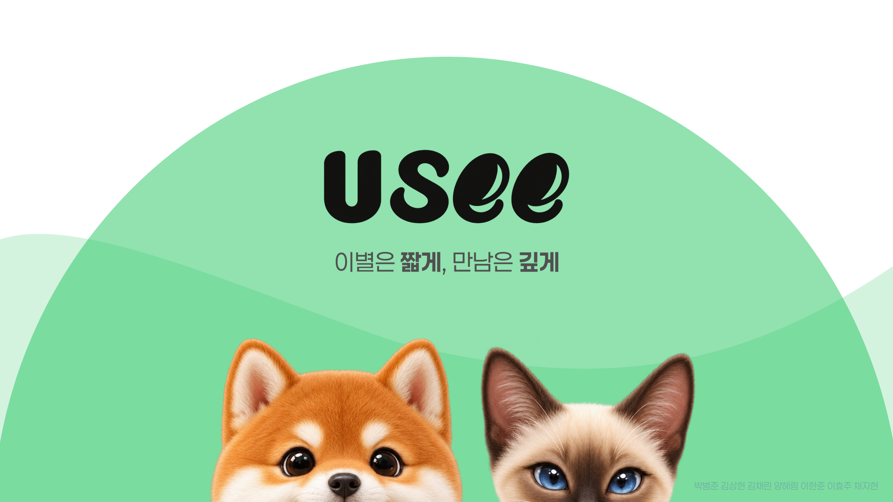
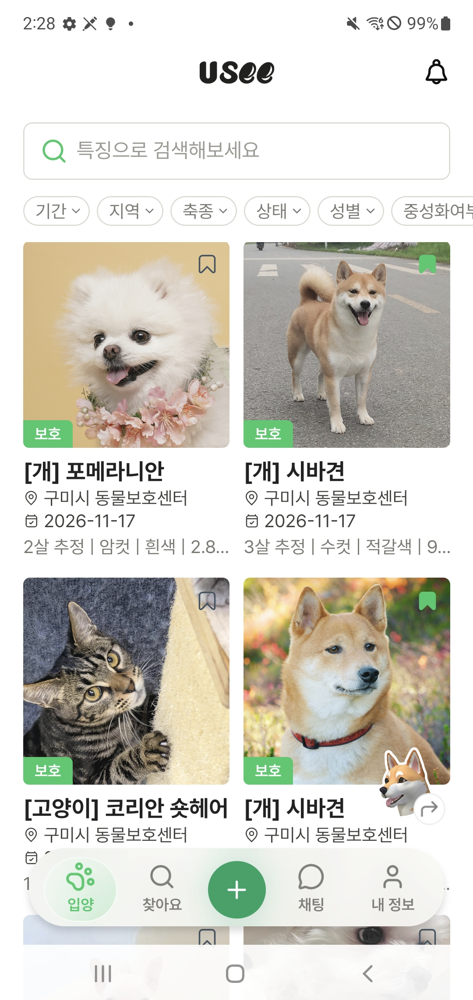
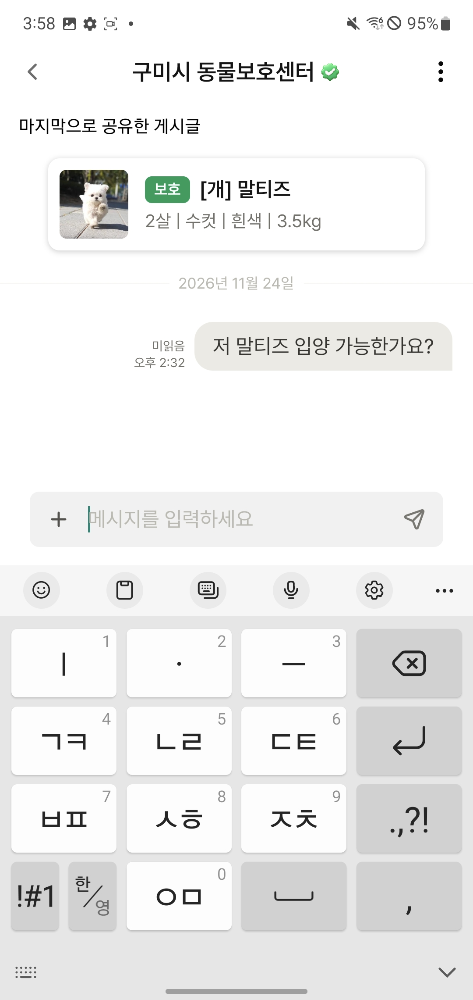
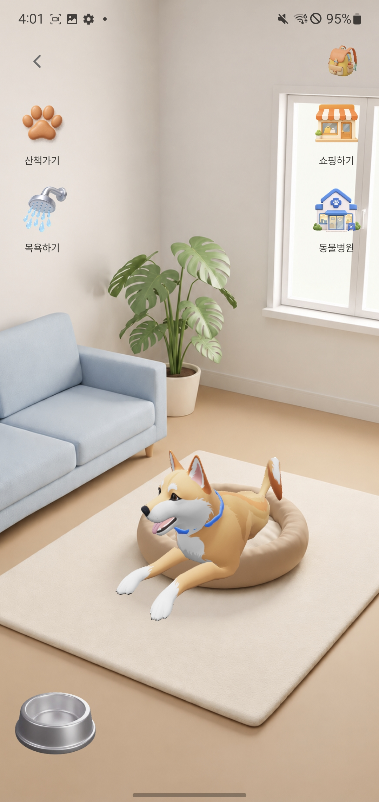
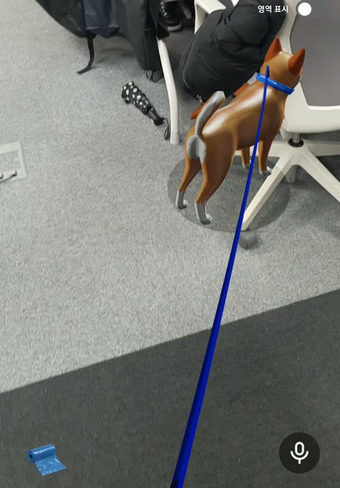
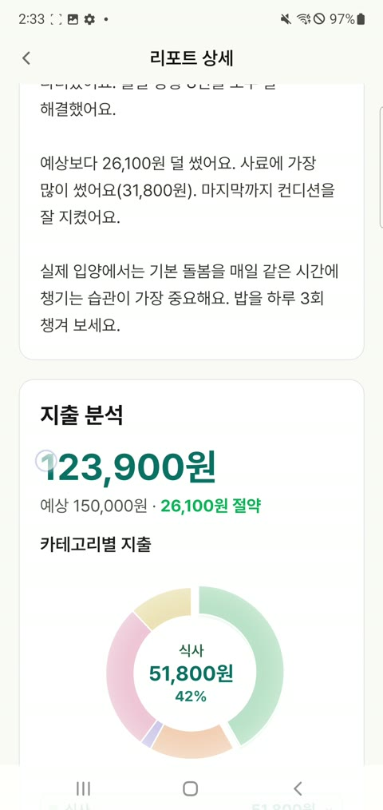
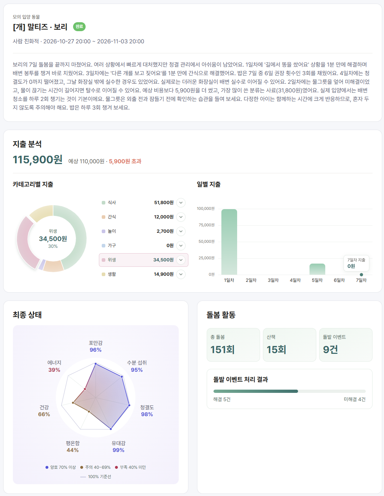
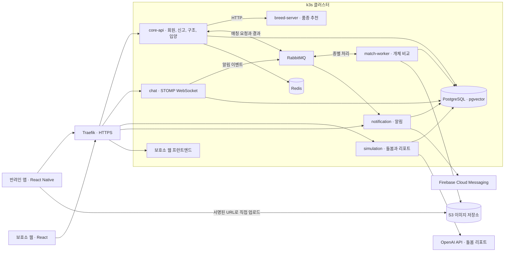

# USee · 반려동물 실종 신고와 입양 준비를 잇는 서비스

반려인이 **실종 동물의 사진과 특징을 등록하면**, USee가 발견 제보와 보호동물 사진을 비교해 닮은 후보를 제안합니다. 예비 입양자는 **7일 모의 입양**으로 돌봄과 비용을 체험하고, 보호소는 전용 웹에서 보호동물과 입양 신청을 관리합니다.

**2026.10.06 – 2026.12.01 · SSAFY 15기 자유 프로젝트 · 7인 팀**

[서비스 기능](#서비스-기능) · [시연 화면](#시연-화면) · [AI 이미지 매칭](#ai-이미지-매칭) · [아키텍처](#아키텍처) · [기술 스택](#기술-스택) · [개발 가이드](#개발-가이드)

## 기획 배경

실종 동물의 보호자는 여러 제보와 보호 공고를 직접 비교해야 합니다. 입양을 고민하는 사람은 동물을 맞이하기 전에 일상적인 돌봄과 예기치 않은 비용을 가늠하기 어렵습니다. USee는 사진을 바탕으로 확인할 후보를 좁히고, 모의 입양과 보호소 업무를 연결해 입양 전 준비를 돕습니다.

## 서비스 기능

| 기능 | 사용 흐름 |
| --- | --- |
| 실종 신고 · 발견 제보 | 반려인은 사진·특징·실종 위치를 등록합니다. 발견자는 사진과 발견 위치를 제보하고 AI가 제안한 품종을 확인할 수 있습니다. |
| 유사 동물 매칭 | 실종 신고와 발견 제보·보호동물 사진을 비교합니다. 보호자는 유사한 후보가 생기면 알림을 받고 사진과 특징을 대조합니다. |
| 보호동물 탐색 · 소통 | 앱에서 보호동물과 공고를 살펴보고 관심 동물을 저장하거나 채팅으로 문의할 수 있습니다. |
| 7일 모의 입양 | 가상 반려동물에게 밥과 물을 주고 청소·산책을 합니다. 돌발 상황에 대응하고 가상 펫샵에서 필요한 물품을 마련합니다. Android에서 AR 산책을 체험할 수 있습니다. |
| 돌봄 리포트 | 행동 기록과 지출, 돌발 이벤트 대응, 종료 시점의 상태를 요약합니다. 수의사 자문을 바탕으로 정리한 양육 지식을 참고해 LLM이 개선할 점을 설명합니다. |
| 보호소 전용 웹 | 보호동물 정보를 등록·수정하고, 입양 신청 목록과 상세를 확인해 심사합니다. |

## 시연 화면

| 보호동물 탐색 | 보호소와 채팅 | 모의 입양 |
| :---: | :---: | :---: |
|  |  |  |

| 돌봄 · AR 산책 | 돌봄 리포트 |
| :---: | :---: |
|  |  |
| [시연 영상 MP4](docs/readme/care-and-walk.mp4) | [시연 영상 MP4](docs/readme/care-report.mp4) |

보호소용 돌봄 리포트 예시 보기

## AI 이미지 매칭

1. **품종 추천** · CLIP으로 개와 고양이를 구분하고, 종별 ConvNeXt-Tiny 모델이 각 15개 지원 품종 중 후보를 제안합니다. 등록할 품종은 사용자가 확인합니다.
2. **후보 선별** · 백엔드가 종과 신고 위치·시각을 기준으로 비교 대상을 좁힙니다. RabbitMQ를 통해 사진 비교 요청을 워커에 전달합니다.
3. **개체 검색** · 개는 YOLO11m-seg와 BowwowID, 고양이는 ECPose와 MeowID를 사용합니다. 사진의 특징을 512차원 벡터로 저장하고 pgvector에서 코사인 유사도를 계산합니다. 고양이 얼굴이 잘 보이지 않을 때는 몸 특징을 이용합니다.
4. **후보 알림** · 워커가 결과를 발행하면 백엔드가 유사 동물 후보를 알립니다. 유사도 순위는 보호자가 먼저 확인할 후보를 정하는 데 활용됩니다.

발표 검증셋에서 품종 분류 Top-1 정확도는 **개 97.52%, 고양이 93.98%**였습니다. 이 수치는 지원 품종 분류에 대한 평가입니다.

## 아키텍처

`core-api`, `chat`, `notification`, `simulation`을 독립 배포합니다. PostgreSQL 인스턴스 안에서 서비스별 스키마와 계정을 분리하고, 서비스 사이에서 전달할 작업은 RabbitMQ 이벤트로 처리합니다. 품종 추천 서버는 내부 HTTP로 호출하고, 개체 매칭 워커는 큐에서 메시지를 받아 실행합니다.

GitLab CI가 변경된 서비스의 이미지를 빌드하고 Kustomize 매니페스트의 이미지 태그를 갱신합니다. Argo CD가 선언된 상태를 k3s에 반영합니다. Prometheus·Grafana로 메트릭을 보고 Loki·Alloy로 로그를 수집합니다. PostgreSQL 백업은 S3에 보관합니다.

## 기술 스택

| 영역 | 주요 기술 |
| --- | --- |
| Mobile | React Native, TypeScript, Zustand, Kakao Login, Naver Maps, Firebase Messaging, Android ARCore |
| Web | React, TypeScript, Vite, TanStack Query, Zustand, STOMP.js |
| Backend | Kotlin, Java 21, Spring Boot, Spring Security, JPA, QueryDSL, Flyway, STOMP WebSocket, RabbitMQ |
| Data · 외부 연동 | PostgreSQL, pgvector, Redis, AWS S3, Firebase Cloud Messaging, OpenAI API |
| AI | Python, FastAPI, PyTorch, CLIP, ConvNeXt-Tiny, BowwowID, MeowID, ONNX Runtime |
| Infra | AWS Lightsail·EC2, Terraform, Docker, k3s, Traefik, cert-manager, GitLab CI, Argo CD, Kustomize, Sealed Secrets, Tailscale |
| 관측 · 검증 | Prometheus, Grafana, Loki, Alloy, k6 |

## 개발 가이드

| 경로 | 내용 | 시작하기 |
| --- | --- | --- |
| [`mobile/`](mobile/) | 사용자 앱과 Android AR 기능 | [모바일 README](mobile/README.md) · [개발 환경](mobile/docs/DEVELOPMENT.md) |
| [`web/`](web/) | 보호소 웹과 입양 심사 | [웹 README](web/README.md) |
| [`backend/`](backend/) | Core API, 채팅, 알림, 시뮬레이션, 공통 모듈 | [백엔드 README](backend/README.md) |
| [`ai/`](ai/) | 품종 추천과 개체 매칭 | [품종 추천 서버](ai/breed-server/README.md) · [매칭 워커](ai/match-worker/README.md) |
| [`infra/`](infra/) | GitOps 매니페스트, 배포 및 인프라 코드 | [Argo CD 진입점](infra/argocd/root.yaml) |

기능별 개발 브랜치는 `develop-mobile`, `develop-web`, `develop-backend`, `develop-ai`, `infra`입니다. 웹·모바일은 각 README의 Node.js와 기기 환경을, 백엔드는 JDK 21과 로컬 Docker Compose 설정을 따릅니다.
